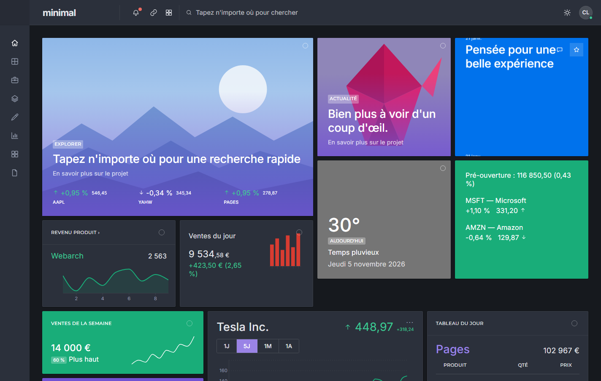
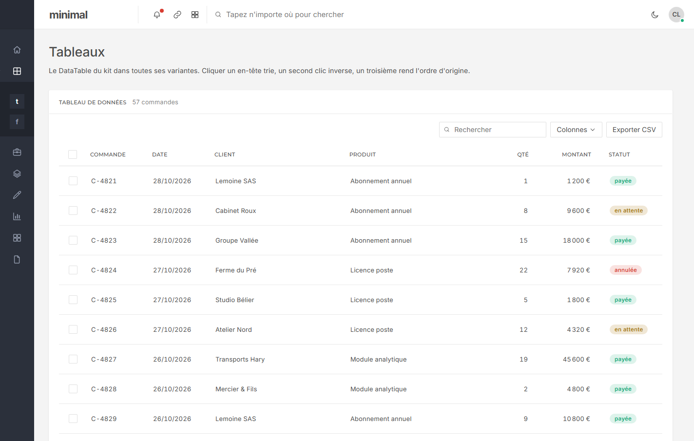
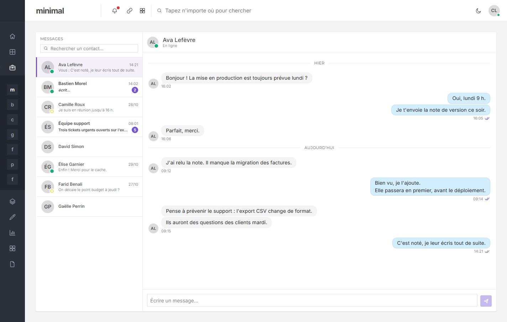
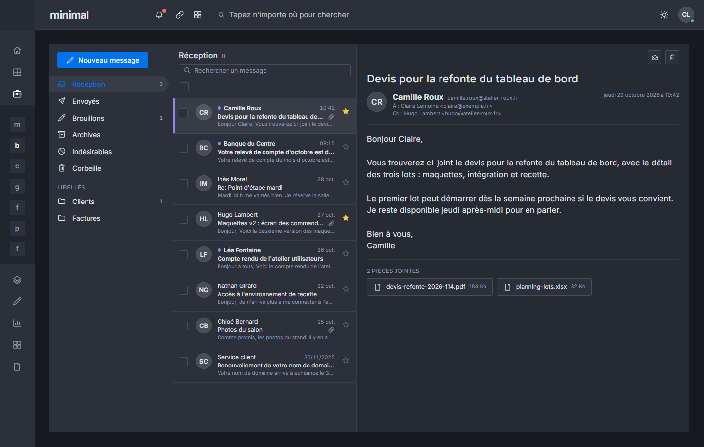
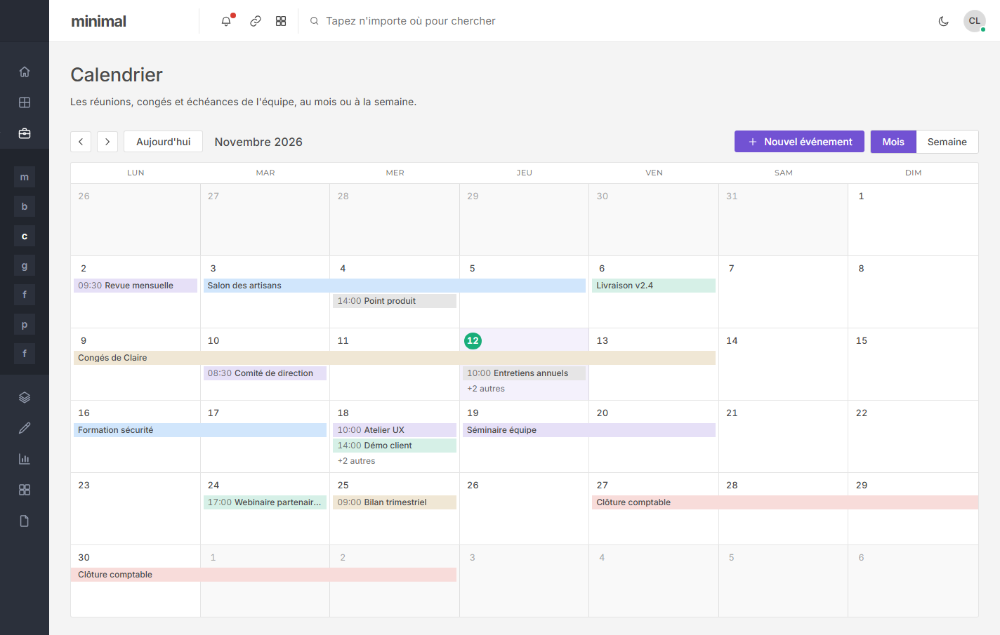
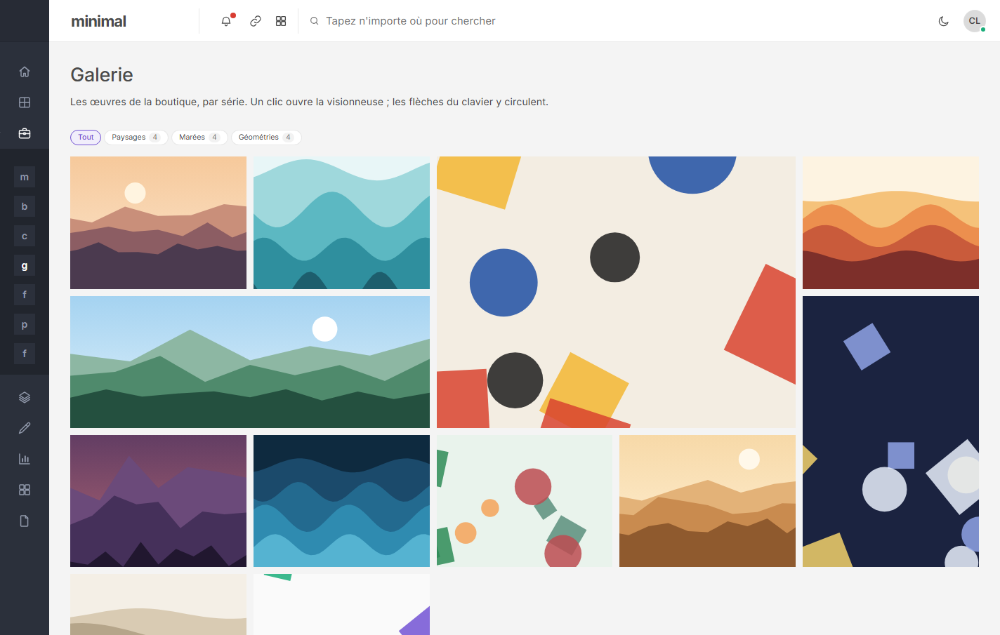
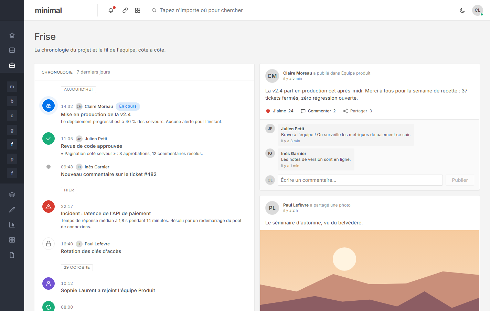
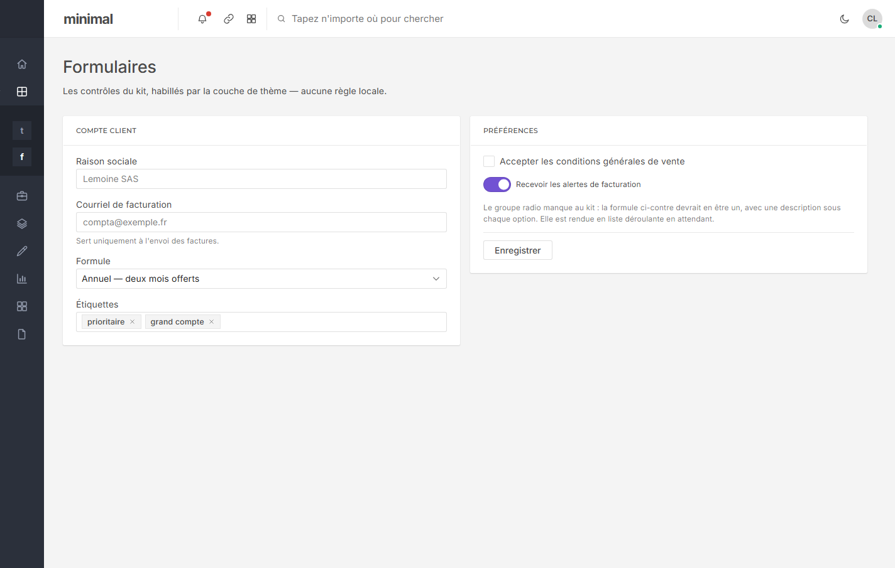
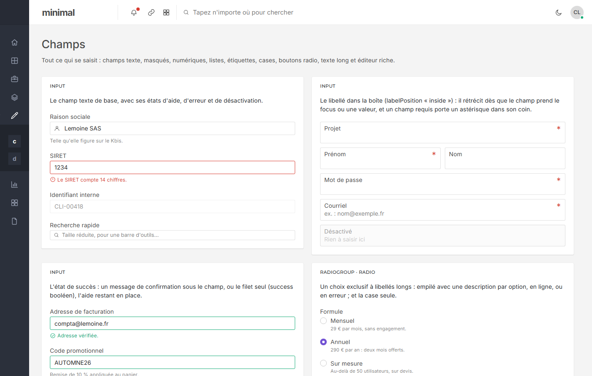

# minimal-dashboard-kit

Une **couche de thème** par-dessus [`@michaelthomasjach/liseuse-dashboard-kit`](https://github.com/michaelthomasjach/liseuse-dashboard-kit),
et la vitrine qui la montre.

Le kit porte la logique des composants ; ce dépôt ne porte que leur apparence, plus les écrans de
démonstration. Aucun composant n'est réécrit ici tant qu'une variable suffit à le rhabiller.

**En ligne :** [Storybook](https://michaelthomasjach.github.io/minimal-dashboard-kit/) — chaque composant, son code et ses props ·
[Vitrine](https://michaelthomasjach.github.io/minimal-dashboard-kit/vitrine/) — le tableau de bord, les écrans d'application et une planche par famille.

## Aperçu


| | |
|---|---|
|  |  |
| **Surface sombre** — dérivée de la barre latérale du gabarit | **Tableaux** — pagination, recherche, sélection, export, en-tête figé |
|  |  |
| **Messagerie** — `ChatPanel` | **Boîte mail** — `MailPanel`, en sombre |
|  |  |
| **Calendrier** — `MonthCalendar` | **Galerie** — `Gallery` et sa visionneuse |
|  |  |
| **Frise et fil d'activité** — `Timeline`, `ActivityFeed` | **Formulaires** — champs à libellé intégré |



Les illustrations des écrans sont générées en code (SVG) ; aucune image ni aucun code du gabarit
Pages n'est repris — seules ses valeurs (couleurs, tailles, ombres) ont été mesurées.

## Comment ça marche

Le kit ne code aucune couleur, aucun rayon, aucun espacement en dur : ses ~200 composants lisent
tous une soixantaine de variables CSS `--lq-*` posées sur leur ancêtre `.lq-root`. Ce dépôt en
redéfinit l'intégralité dans [`src/theme/minimal.css`](src/theme/minimal.css), sous un sélecteur
strictement plus spécifique que ceux du kit — donc gagnant quel que soit l'ordre des imports.

```
.mdk.lq-root[data-lq-palette][data-lq-surface="light"]   (0,4,0)  >  .lq-root[data-lq-palette="color"][data-lq-surface="light"]   (0,3,0)
.mdk.lq-root                                             (0,2,0)  >  .lq-root                                                     (0,1,0)
```

La classe `mdk` est posée par `MinimalTheme`, seul point d'entrée de la couche :

```tsx
import { MinimalTheme } from "./theme";

<MinimalTheme surface="light">
  <App />
</MinimalTheme>;
```

## Ce qui va où

| | Dépôt |
|---|---|
| Logique d'un composant, correctif, composant manquant | **le kit** |
| Couleurs, rayons, espacements, échelle typographique | **ici**, `src/theme/minimal.css` |
| Refonte d'anatomie (densité, chrome, position d'un libellé) | **ici**, `src/theme/` — un composant qui enveloppe celui du kit |
| Écrans, navigation, données de démonstration | **ici**, `src/showcase/` |

La règle qui tranche : une variable ne peut pas **déplacer** un élément. Tant qu'il s'agit de
couleur, de taille ou d'espace, c'est `minimal.css`. Dès qu'il faut qu'un libellé passe à gauche ou
qu'un en-tête descende sous un filet, c'est un composant.

Et un corollaire qu'on tient : **aucun contournement local d'un manque du kit**. Si `DataTable` n'a
pas de pagination, on l'ajoute dans le kit, pas ici — sinon les deux dépôts divergent et la couche
perd sa raison d'être.

## Ajouter un écran

Un seul geste. Le registre [`src/showcase/screens/index.tsx`](src/showcase/screens/index.tsx)
produit à la fois le menu et les routes, qui ne peuvent donc pas se contredire :

```tsx
export const SCREENS: Screen[] = [
  …,
  { id: "factures", label: "Factures", path: "factures", group: "Données", render: () => <Invoices /> },
];
```

## Utiliser le paquet

Publié sur GitHub Packages sous `@michaelthomasjach/minimal-dashboard-kit`. Il ré-exporte **tous**
les composants du kit et ajoute `MinimalTheme` : une seule dépendance à déclarer.

```ini
# .npmrc de l'application — le jeton reste une variable d'environnement
@michaelthomasjach:registry=https://npm.pkg.github.com
//npm.pkg.github.com/:_authToken=${GITHUB_TOKEN}
```

```sh
npm install @michaelthomasjach/minimal-dashboard-kit react react-dom d3
```

```tsx
import { MinimalTheme, Card, DataTable } from "@michaelthomasjach/minimal-dashboard-kit";
import "@michaelthomasjach/minimal-dashboard-kit/style.css";

<MinimalTheme surface="light">
  <App />
</MinimalTheme>;
```

Les polices (Inter, Montserrat) sont embarquées via `@fontsource` : rien n'est demandé à Google
Fonts. Pour publier une nouvelle version : `npm version patch|minor`, puis `npm publish`
(`prepublishOnly` construit `dist-lib/` avec `vite.config.lib.ts`).

## Démarrer

```bash
npm install     # a besoin de GITHUB_TOKEN dans le shell — le kit est sur GitHub Packages
npm run dev
```

`npm run build` lance le typecheck avant la construction.

## État

Première pose : le système de variables (surface claire et sombre), la coquille, le registre
d'écrans et trois écrans de référence — vue d'ensemble, tableaux, formulaires. Ces trois-là ne sont
pas choisis au hasard : ce sont les trois endroits où le comparatif du kit a trouvé des trous, et
ils les montrent au lieu de les masquer.

Manques connus, à combler **dans le kit** :

- `Radio` / `RadioGroup` — le seul contrôle de formulaire standard absent (voir l'écran Formulaires).
- `DataTable` : pagination, sélection de lignes, filtre, en-tête figé, export (voir l'écran Tableaux).
- `ButtonGroup`, cercle de progression, onglets verticaux.
